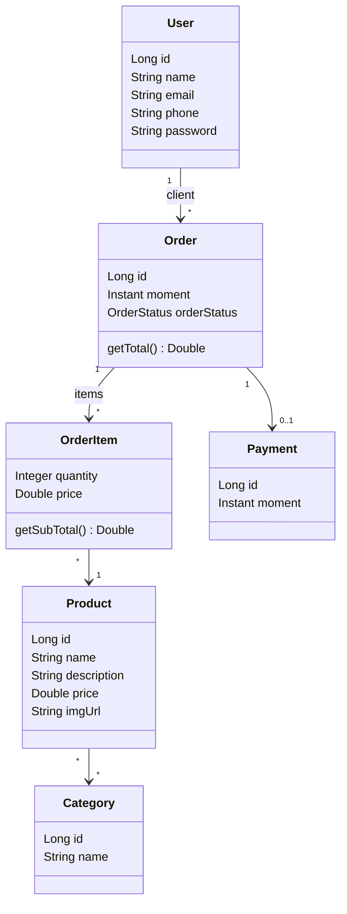

# Spring Boot Orders API

API REST de um sistema de pedidos, desenvolvida com **Java** e **Spring Boot**. Ela gerencia usuários, produtos, categorias e pedidos: cada usuário pode fazer vários pedidos, cada pedido contém itens com produto, quantidade e preço, e um pedido pode ter um pagamento.


---

## Funcionalidades

- CRUD completo de usuários (criar, buscar, atualizar e apagar)
- Consulta de pedidos, produtos e categorias
- Cálculo do subtotal de cada item e do total do pedido
- Status do pedido com enum (`WAITING_PAYMENT`, `PAID`, `SHIPPED`, `DELIVERED`, `CANCELED`)
- Tratamento de erros com respostas padronizadas (404 e 400)
- Banco H2 em memória para testes e PostgreSQL para desenvolvimento
- Carga de dados de exemplo ao iniciar a aplicação no perfil de teste

---

## Modelo de domínio



Relacionamentos mapeados com JPA:

| Relação | Tipo | Como foi mapeada |
|---|---|---|
| Usuário e pedidos | Um para muitos | `@OneToMany` / `@ManyToOne` |
| Produto e categorias | Muitos para muitos | `@ManyToMany` com `@JoinTable` |
| Pedido e produtos | Muitos para muitos com atributos extras | Classe `OrderItem` com chave composta (`@EmbeddedId`) |
| Pedido e pagamento | Um para um | `@OneToOne` com `@MapsId` |

---

## Tecnologias

- **Java 21**
- **Spring Boot 4.1.2** (Spring Web e Spring Data JPA)
- **JPA / Hibernate**
- **H2 Database** (perfil `test`)
- **PostgreSQL** (perfil `dev`)
- **Maven**
- **Postman** para testar os endpoints

---

## Arquitetura

O projeto segue uma arquitetura em camadas:

```
Requisição → Resource (controller) → Service → Repository → Banco de dados
```

| Camada | Pacote | Responsabilidade |
|---|---|---|
| Entidades | `entities` | Classes mapeadas para tabelas do banco |
| Repositórios | `repositories` | Acesso aos dados com Spring Data JPA |
| Serviços | `services` | Regras de negócio |
| Recursos | `resources` | Endpoints REST |
| Configuração | `config` | Carga de dados de teste |

---

## Endpoints

### Usuários

| Método | Endpoint | Descrição | Status de sucesso |
|---|---|---|---|
| GET | `/users` | Lista todos os usuários | 200 |
| GET | `/users/{id}` | Busca um usuário pelo id | 200 |
| POST | `/users` | Cadastra um usuário | 201 |
| PUT | `/users/{id}` | Atualiza um usuário | 200 |
| DELETE | `/users/{id}` | Apaga um usuário | 204 |

### Pedidos, produtos e categorias

| Método | Endpoint | Descrição |
|---|---|---|
| GET | `/orders` e `/orders/{id}` | Lista os pedidos ou busca um pelo id |
| GET | `/products` e `/products/{id}` | Lista os produtos ou busca um pelo id |
| GET | `/categories` e `/categories/{id}` | Lista as categorias ou busca uma pelo id |

### Exemplo: cadastrar um usuário

`POST /users`

```json
{
  "name": "Bob Brown",
  "email": "bob@gmail.com",
  "phone": "977557755",
  "password": "123456"
}
```

### Tratamento de erros

| Situação | Status |
|---|---|
| Buscar, atualizar ou apagar um id que não existe | 404 Not Found |
| Apagar um usuário que tem pedidos (violação de integridade) | 400 Bad Request |

Exemplo de resposta de erro:

```json
{
  "timestamp": "2026-11-11T14:30:00Z",
  "status": 404,
  "error": "Resource not found",
  "message": "Resource not found. Id 10",
  "path": "/users/10"
}
```

---

## Como executar

### Pré-requisitos

- Java 21
- Maven (ou o Maven Wrapper incluído no projeto)

### Passos

```bash
# clonar o repositório
git clone https://github.com/wedney-almeida/springboot-orders-api.git
cd springboot-orders-api

# executar a aplicação
./mvnw spring-boot:run
```

No Windows, use `mvnw.cmd spring-boot:run`.

A API fica disponível em `http://localhost:8080`.

### Perfis

O perfil ativo é definido em `src/main/resources/application.properties`, na propriedade `spring.profiles.active`.

- **`test`:** usa o banco H2 em memória e já carrega dados de exemplo. O console do H2 fica em `http://localhost:8080/h2-console`. É o jeito mais rápido de testar.
- **`dev`:** usa o PostgreSQL. Crie um banco chamado `springboot_course` e ajuste o usuário e a senha em `application-dev.properties`.

---

## Próximos passos

- [ ] Deploy da API em um serviço de nuvem
- [ ] Testes unitários com JUnit e Mockito
- [ ] DTOs e validação dos dados de entrada
- [ ] Documentação dos endpoints com Swagger
- [ ] Senha criptografada e autenticação

---

## Créditos

Projeto desenvolvido durante o curso *Java COMPLETO: Programação Orientada a Objetos + Projetos*, de Nelio Alves (Udemy), adaptado para Java 21 e Spring Boot 4.

## Autor

**Wedney Almeida**, estudante de Análise e Desenvolvimento de Sistemas e desenvolvedor Java backend em formação.

- GitHub: [wedney-almeida](https://github.com/wedney-almeida)
- LinkedIn: _adicione aqui o link do seu perfil_
